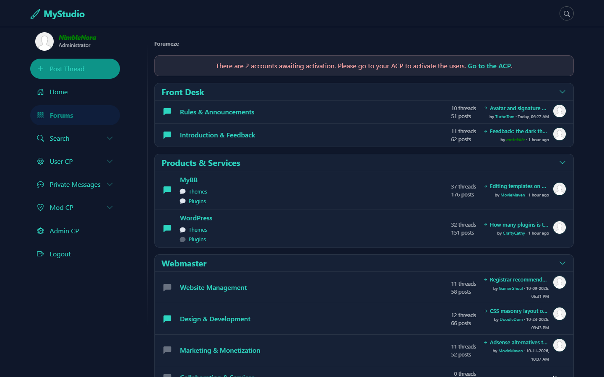
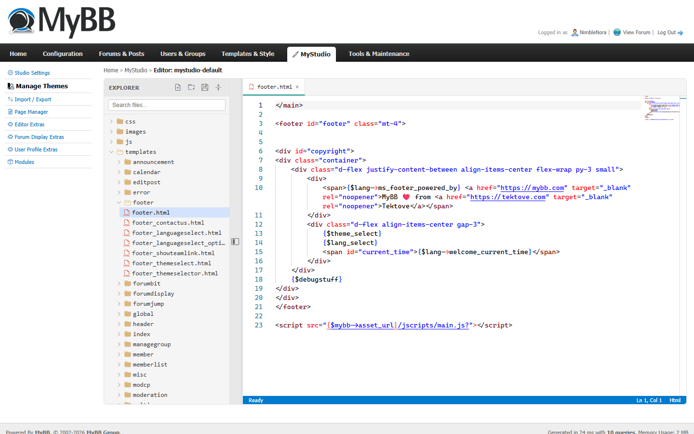

# MyStudio documentation

MyStudio is a theme and extension manager for MyBB 1.8. It lets you build forum themes as ordinary files instead of database rows, and add features as switch-on modules.

## Start here

| Guide | Read it if you want to… |
|-------|-------------------------|
| [Getting started](getting-started.md) | install MyStudio and switch your forum to the new theme |
| [How the theme system works](theme-system.md) | understand files, syncing, options, and why this suits AI coding assistants |
| [Create a theme](create-a-theme.md) | build your own theme, by copying the default or from scratch |
| [Create a module](create-a-module.md) | add a feature (a MyStudio "plugin") with its own settings page |

## Words you'll see

| Word | Meaning |
|------|---------|
| **Theme** | A forum's look: templates (HTML), stylesheets (CSS), scripts and images. In MyStudio a theme is a folder in `themes/`. |
| **Slug** | A theme's or module's folder name, e.g. `mystudio-default`. Lowercase, no spaces. |
| **Template** | One piece of a page's HTML, such as the header or a post. MyBB builds pages from hundreds of them. |
| **Sync** | Copying your theme files into the database so MyBB can use them. |
| **Module** | A feature you can switch on or off under **MyStudio → Modules**. MyStudio's version of a plugin. |
| **Hook** | A point in MyBB's code where your PHP can run, e.g. "just before the page is sent". |
| **Admin CP** | MyBB's administration area, usually at `yourforum.com/admin/`. |

## Screenshots

| | |
|---|---|
|  |  |
| Forum index in MyStudio Default | The built-in theme editor |

More in [`screenshots/`](screenshots/).
