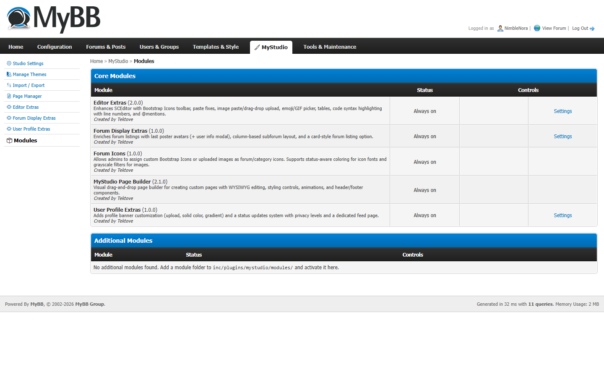

# Create a module (a MyStudio plugin)

A **module** is MyStudio's version of a plugin: a self-contained feature you can switch on and off from the Admin CP. The editor upgrades, forum icons and profile banners that ship with MyStudio are all modules.

This guide builds a small but complete module step by step: an **announcement bar** across the top of every page, with a settings form so admins can change the message and colour.

## Module or classic MyBB plugin?

| | MyStudio module | Classic MyBB plugin |
|---|---|---|
| Lives in | `inc/plugins/mystudio/modules/{id}/` | `inc/plugins/{name}.php` |
| Switched on in | **MyStudio → Modules** | **Configuration → Plugins** |
| Settings form | Write a short list in `options.php`. MyStudio builds the form. | Create setting groups and settings in the database yourself. |
| CSS and JavaScript | Drop files in `css/` and `js/`. They load on every page automatically. | Edit templates or inject tags yourself. |
| Settings stored in | A `default.json` file next to the module | The `settings` table |
| Install/uninstall code | Not needed for most modules | Required |

Use a module when your feature is part of a MyStudio-powered forum. Write a classic plugin when it must work on any MyBB forum, with or without MyStudio.

## What a module looks like

```
inc/plugins/mystudio/modules/ms-announce-bar/
├── plugin.json        name, version, description (required)
├── init.php           your PHP: registers MyBB hooks (required)
├── default.json       saved settings (written for you by the Admin CP)
├── css/
│   └── announce-bar.css   loaded on every page while the module is on
└── js/                    (optional) scripts, also loaded on every page

admin/modules/mystudio/modules/ms-announce-bar/
└── options.php        the settings form definition (optional)
```

The folder name is the module's **ID**. Use lowercase letters, numbers and hyphens. Starting it with your own prefix (for example `acme-announce-bar`) avoids clashes with other people's modules.

---

## Step 1: create the folder and `plugin.json`

Create `inc/plugins/mystudio/modules/ms-announce-bar/plugin.json`:

```json
{
    "name": "Announcement Bar",
    "description": "Shows a dismissible message across the top of every page.",
    "version": "1.0.0",
    "author": "Your Name"
}
```

`name` is required. Without it, MyStudio ignores the folder.

## Step 2: define the settings form

Create `admin/modules/mystudio/modules/ms-announce-bar/options.php`. It returns a list of settings. MyStudio turns that list into a form in the Admin CP.

```php
<?php
if (!defined('IN_MYBB')) {
    die('Direct initialization of this file is not allowed.');
}

return array(
    array(
        'id'          => 'message',
        'label'       => 'Message',
        'description' => 'The text shown in the bar. Leave empty to hide the bar.',
        'type'        => 'text',
        'default'     => 'Welcome! Read the forum rules before posting.',
    ),
    array(
        'id'          => 'colour',
        'label'       => 'Background colour',
        'description' => 'Bar background colour.',
        'type'        => 'color',
        'default'     => '#0d9488',
    ),
);
```

Each setting needs an `id`, `label`, `type` and `default`. Types you can use: `text`, `textarea`, `yesno`, `select`, `radio`, `color`, `numeric`, `image`, `icon_chooser`. For `select` and `radio`, add `'options' => array('value' => 'Label', ...)`.

## Step 3: write `init.php`

Create `inc/plugins/mystudio/modules/ms-announce-bar/init.php`. MyStudio runs this file on every page while the module is active.

```php
<?php
if (!defined('IN_MYBB')) {
    die('Direct initialization of this file is not allowed.');
}

global $plugins;

// $ms_plugin_options holds this module's saved settings. It only exists while
// this file runs, so keep a copy for the hook function below.
$GLOBALS['announce_bar_options'] = $ms_plugin_options;

// init.php also runs inside the Admin CP. Only hook the public forum.
if (!defined('IN_ADMINCP')) {
    $plugins->add_hook('pre_output_page', 'announce_bar_output');
}

function announce_bar_output($page)
{
    $opts = $GLOBALS['announce_bar_options'];

    $message = trim(isset($opts['message']) ? $opts['message'] : '');
    if ($message === '') {
        return $page;
    }

    // Never trust settings blindly: escape text, and only accept a real hex colour.
    $message = htmlspecialchars_uni($message);
    $colour  = isset($opts['colour']) ? $opts['colour'] : '';
    if (!preg_match('/^#[0-9a-fA-F]{3,8}$/', $colour)) {
        $colour = '#0d9488';
    }

    $bar = '<div class="announce-bar" style="background:' . $colour . '">'
         . '<span>' . $message . '</span>'
         . '<button type="button" class="announce-bar-close" aria-label="Close"'
         . ' onclick="this.parentNode.remove()">&times;</button>'
         . '</div>';

    // Insert the bar straight after the opening <body> tag. The pattern only matches a
    // real tag ("<body>" or "<body class=...>"), not "<body" text inside inline scripts.
    return preg_replace('#<body(\s[^>]*)?>#i', '$0' . $bar, $page, 1);
}
```

What's going on:

- **`$plugins->add_hook('pre_output_page', ...)`** asks MyBB to call your function just before it sends a page to the browser. The function gets the page's HTML and returns it, changed or not. [MyBB's hook list](https://docs.mybb.com/1.8/development/plugins/hooks/) shows every hook you can use.
- **`$ms_plugin_options`** is your saved settings, ready to use. MyStudio also gives `init.php` these variables:

  | Variable | What it is |
  |----------|-----------|
  | `$ms_plugin_options` | This module's settings (an array) |
  | `$ms_plugin_dir` | Full path to this module's folder |
  | `$ms_plugin_id` | The module's ID, e.g. `ms-announce-bar` |
  | `$ms_theme_slug` | The active theme's folder name |
  | `$mybb->ms_theme_options` | The active theme's settings |

## Step 4: add some CSS

Create `inc/plugins/mystudio/modules/ms-announce-bar/css/announce-bar.css`:

```css
.announce-bar {
    display: flex;
    align-items: center;
    justify-content: center;
    gap: 1rem;
    padding: .5rem 1rem;
    color: #fff;
    font-weight: 600;
}
.announce-bar-close {
    background: none;
    border: 0;
    color: inherit;
    font-size: 1.25rem;
    cursor: pointer;
}
```

You don't link it anywhere. Every `.css` file in the module's `css/` folder (and every `.js` file in `js/`) loads on every forum page automatically while the module is active.

## Step 5: switch it on

1. Go to **Admin CP → MyStudio → Modules**. Core modules are always on; yours is listed under **Additional Modules**.

   

2. Find **Announcement Bar** and click **Activate**.
3. A new **Announcement Bar** entry appears in the MyStudio sidebar. Open it to change the message and colour.
4. Open your forum. The bar is at the top of every page.

New modules always start switched off, so a half-finished module can never go live by accident.

---

## Going further

### Store data in the database

Create your table the first time the module runs, and check before creating it:

```php
global $db;
if (!$db->table_exists('announce_bar_views')) {
    $db->write_query("CREATE TABLE " . TABLE_PREFIX . "announce_bar_views (
        uid INT UNSIGNED NOT NULL PRIMARY KEY,
        dismissed_at INT UNSIGNED NOT NULL DEFAULT 0
    ) ENGINE=InnoDB");
}
```

> ⚠️ **Important:** in this MyBB build, `$db->insert_query()` and `$db->update_query()` do **not** escape values for you. Always run text through `$db->escape_string()` first, and cast numbers with `(int)`.

### Handle AJAX requests

Hook `xmlhttp` and check the action name:

```php
$plugins->add_hook('xmlhttp', 'announce_bar_ajax');

function announce_bar_ajax()
{
    global $mybb;
    if ($mybb->get_input('action') !== 'announce_bar_dismiss') {
        return;
    }
    // Reject requests that didn't come from your own forum's pages.
    verify_post_check($mybb->get_input('my_post_key'));

    // ... do the work ...
    header('Content-Type: application/json');
    echo json_encode(array('success' => true));
    exit;
}
```

Call it from JavaScript with `xmlhttp.php?action=announce_bar_dismiss&my_post_key=` + `my_post_key`. MyBB defines `my_post_key` on every page.

### Add an extra admin page

Put an `admin.php` file in the module's own folder (`inc/plugins/mystudio/modules/{id}/admin.php`). MyStudio includes it below your settings form on the module's Admin CP page, so you can add tables, buttons or reports. Start it with the same `IN_MYBB` check as `init.php`.

## Checklist before sharing your module

- [ ] `plugin.json` has a `name`, `version` and `description`.
- [ ] `init.php` starts with the `IN_MYBB` check.
- [ ] Front-end hooks are inside `if (!defined('IN_ADMINCP'))`.
- [ ] Everything a user (or admin) typed is escaped with `htmlspecialchars_uni()` before output.
- [ ] Database text goes through `$db->escape_string()`, numbers through `(int)`.
- [ ] Every action that changes data checks `my_post_key` with `verify_post_check()`.
- [ ] Function names start with your module's prefix, so they can't clash with other code.

To share it, zip both folders (`inc/plugins/mystudio/modules/{id}/` and `admin/modules/mystudio/modules/{id}/`). Installers upload them to the same places and activate the module under **MyStudio → Modules**.

## Building modules with an AI assistant

Modules are plain files with a fixed layout, so an AI coding assistant can build one from a short description:

> Create a MyStudio module `acme-reading-time` that adds "x min read" under each thread's title on showthread. Add a yes/no setting to turn it off. Follow the module checklist in docs/create-a-module.md.

Point it at this page and at `CLAUDE.md`, and review the diff it produces against the checklist above.
