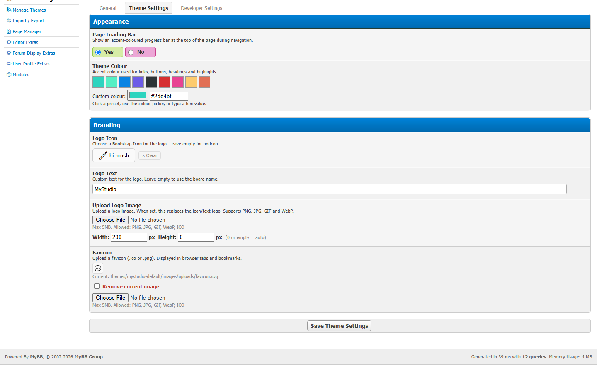

# Getting started with MyStudio

This page gets MyStudio running on your forum in about ten minutes. You don't need to know PHP.

## What you get

- **A modern forum theme.** MyStudio Default is a dark, responsive theme built on Bootstrap 5.
- **A theme manager.** Edit your theme as normal files, in the Admin CP or your own code editor.
- **Modules.** Switch-on features: editor upgrades, forum icons, profile banners, custom pages.

## What you need

| Requirement | Version |
|-------------|---------|
| MyBB | 1.8.38 or newer |
| PHP | 8.0 or newer, with the `zip`, `fileinfo`, `json` and `curl` extensions |
| Database | MySQL 5.7+ or MariaDB 10.3+ |
| Web server | Apache 2.4+ (with `mod_rewrite`) or Nginx |

Not sure? Your host's control panel usually shows the PHP version and extensions. In the Admin CP, **Home** shows the MyBB and PHP versions.

## Install

### 1. Upload the files

Copy these from the MyStudio download into your forum's root folder (the one with `index.php` and `global.php` in it):

```
inc/plugins/ms.php
inc/plugins/mystudio/
admin/modules/mystudio/
jscripts/mystudio/
themes/mystudio-default/
```

If you renamed your `admin` folder, put `admin/modules/mystudio/` inside your renamed folder instead.

### 2. Make folders writable

Your web server needs to write to these folders:

```
themes/
uploads/
cache/themes/
jscripts/
```

On Linux hosting that usually means permissions `755` (or `775`), owned by the web server user. Your host's file manager can usually set this.

### 3. Install the plugin

1. Log in to the **Admin CP**.
2. Go to **Configuration → Plugins**.
3. Find **MyStudio** and click **Install & Activate**.

A new **MyStudio** section appears at the top of the Admin CP.

### 4. Load the theme into the database

1. Go to **MyStudio → Manage Themes**.
2. Next to **MyStudio Default**, click **Options** and choose **Sync from Disk**.

This copies the theme's files into MyBB. You'll do this again whenever you change theme files outside the built-in editor. [How the theme system works](theme-system.md) explains why.

### 5. Switch your forum to the new theme

Click **Options → Set as Default** next to MyStudio Default. Open your forum and press **Ctrl+Shift+R** (Cmd+Shift+R on a Mac) to reload without the browser cache.

### 6. Make it yours

Go to **MyStudio → Studio Settings → Theme Settings**:

- **Theme colour:** pick one of the presets or enter your own.
- **Branding:** upload a logo and favicon, or choose an icon and site name.



Then look at **MyStudio → Modules** to switch extra features on.

### Optional: clean URLs for custom pages

If you use the Page Builder module and want addresses like `yourforum.com/rules`, add this to your forum's `.htaccess` file (Apache):

```apache
RewriteCond %{REQUEST_FILENAME} !-f
RewriteCond %{REQUEST_FILENAME} !-d
RewriteRule ^([a-zA-Z0-9\-_/]+)$ misc.php?ms_page=$1 [L,QSA]
```

## A tour of the Admin CP

| Page | What it's for |
|------|---------------|
| **Studio Settings** | Theme colour, logo, favicon, loading bar, upload limit and developer tools |
| **Manage Themes** | See every MyStudio theme. Sync, edit, export, activate or delete. |
| **Import / Export** | Install a theme from a ZIP, or download one as a ZIP |
| **Page Manager** | Create standalone pages (when the Page Builder module is active) |
| **Modules** | Switch optional modules on or off |
| *(module name)* | Settings for each active module that has them |

### The theme editor

**Manage Themes → Edit Theme** opens a full-screen code editor with:

- a file tree of the whole theme
- tabs for several open files
- the same editing engine as Visual Studio Code, including Emmet shortcuts
- **Ctrl+S** to save and update the forum in one step

### Who can use MyStudio?

When MyStudio is activated, every member of the **Administrators** group gets access to all MyStudio pages. To limit an admin to certain pages, use **Users & Groups → Admin Permissions** and look for the **MyStudio** tab.

## For developers: demo data

**Studio Settings → Developer Settings → Demo Data** fills a test forum with sample forums, threads, posts and users so you can see the theme with real content.

> ⚠️ Demo data **deletes your forum's content**. It only works on development sites (addresses like `localhost`, `*.local` or `*.test`) and only for super admins.

## Uninstalling

**Configuration → Plugins → MyStudio → Uninstall** removes MyStudio's settings. Your theme folders in `themes/` are **kept**, because they may be the only copy of your work. Delete them by hand if you no longer need them.

## Next steps

- [How the theme system works](theme-system.md): the five-minute explanation
- [Create a theme](create-a-theme.md)
- [Create a module](create-a-module.md)
